<div align="center">



# Cyberpunk Themes for Claude Code

**Custom Claude Code themes: eight little pixel-art cyberpunk worlds that live behind your chat. One command to switch between them.**

I spend most of my day in the Claude Code desktop app and wanted it to feel less like a tool and more like a place, so I made this.

[](CHANGELOG.md)
[](LICENSE)
[](https://code.claude.com/docs/en/plugins/mods/overview)
[](#the-themes)
[](#accessibility)
[](https://github.com/nocashflow/claude-cyberpunk-themes/actions/workflows/audit.yml)

[Website](https://nocashflow.github.io/claude-cyberpunk-themes/) · [Install](#install) · [Themes](#the-themes) · [Usage](#usage) · [Make it yours](#make-it-yours-with-claude) · [FAQ](#faq) · [Security](#security-and-privacy)

</div>

---

## Why I made this

Listen, choom. No self-respecting edgerunner jacks in to a plain grey chat window all day. So I chromed up Claude Code with a few districts' worth of neon, and I didn't even have to sell a kidney to a ripperdoc for it. Now every chat has its own little corner of the city humming behind it. Preem, right? (If your code still won't compile, that's a skill issue, not a chrome issue.)

Each theme is two things:

- **An animated scene** drawn behind the conversation: rain, flying cars, holograms, small characters doing their thing.
- **A full colour palette** for the app: panels, text, links, code blocks and diffs.

It's all pixel art, heavily inspired by *Cyberpunk: Edgerunners*. Everything is drawn from scratch, though: no game or show assets.

The scenes are meant to be noticed, but never to get in the way of actually working. I kept everything soft and slow on purpose. Nothing flashes, and the text always sits on frosted glass.

## Install

In the Claude Code desktop app, type this in the message box:

```
/plugin install cyberpunk-themes --marketplace nocashflow/claude-cyberpunk-themes
```

Say `y` to add the marketplace, then pick a scope. I'd go with **user**, so the themes work in every project. It's quicker than a ripperdoc install, and nobody touches your spine. Then pick a theme:

```
/neon rooftop
```

> [!NOTE]
> You'll need the Claude Code **desktop app** (Code tab) on v2.1.324 or later. The terminal doesn't draw backdrops, so you won't see anything there. If you have another backdrop theme on (like the example plugin's `/custom-theme`), turn it off first, or the two will fight over the background.

## The themes

<table>
  <tr>
    <td colspan="2" width="66%">
      
      <br><b>Neon Rooftop</b> &nbsp;<code>/neon rooftop</code>
      <br><sub>Purple · dark mode. The first one I made. Two mascots sitting on a roof watching the moon while an ad blimp floats past and a giant hologram eye keeps an eye on everyone.</sub>
    </td>
    <td width="33%">
      
      <br><b>Phosphor Alley</b> &nbsp;<code>/neon alley</code>
      <br><sub>Green · dark mode. The one I made for my room. Rain, an LED umbrella on a power line, a hologram jellyfish, and a cat that refuses to leave the AC unit.</sub>
    </td>
  </tr>
  <tr>
    <td width="33%">
      
      <br><b>Deep Net</b> &nbsp;<code>/neon net</code>
      <br><sub>Blue · dark mode. Inside cyberspace, where a netrunner is quietly breaking through a wall of ICE.</sub>
    </td>
    <td width="33%">
      
      <br><b>Ripperdoc</b> &nbsp;<code>/neon clinic</code>
      <br><sub>Green · dark mode. A sketchy back-alley clinic. The doc is fitting a new chrome arm and the patient seems fine with it.</sub>
    </td>
    <td width="33%">
      
      <br><b>Badlands</b> &nbsp;<code>/neon badlands</code>
      <br><sub>Orange · dark mode. Out in the desert at sunset with a couple of nomads and their car.</sub>
    </td>
  </tr>
  <tr>
    <td colspan="2" width="66%">
      
      <br><b>Blackwall</b> &nbsp;<code>/neon blackwall</code>
      <br><sub>Black · dark mode. My favourite to code in at night. Almost pure black with one red accent. Something's watching through the cracks, and something much bigger is standing in the fog.</sub>
    </td>
    <td width="33%">
      
      <br><b>Corpo Plaza</b> &nbsp;<code>/neon corpo</code>
      <br><sub>White · <b>light mode</b>. For the light-mode people. Spotless, a little too perfect, very corporate.</sub>
    </td>
  </tr>
  <tr>
    <td colspan="3" align="center">
      
      <br><b>Neon 2099</b> &nbsp;<code>/neon noodle</code>
      <br><sub>Pink · dark mode. Late noodles at the foot of the megacity. Claude codes at the counter, jacked in, while the cook keeps the pot going and the rain keeps falling.</sub>
    </td>
  </tr>
</table>

Every scene is animated: what you see above is exactly what the plugin draws. Each theme also recolours the whole app to match. Pick your district, choom.

<details>
<summary><b>Little details to look out for</b></summary>

| Theme | Look for |
| --- | --- |
| **Neon Rooftop** | Searchlights sweeping from the megacorp tower, flying cars with light trails, the ad blimp, the hologram eye, signs in a made-up pixel script, a train going past, and a tiny heart that floats up between the two now and then. |
| **Phosphor Alley** | The jellyfish glitching, pigeons and a pair of sneakers on the wires, steam off the noodle sign, someone's code scrolling in a window, rain rings in the puddles. |
| **Deep Net** | The grid flowing towards you, a scan climbing the data towers, the ICE breach pulsing, packets running to the netrunner, the cable going up from their headset into the sky. |
| **Ripperdoc** | The heart monitor (72 bpm, they're calm), eyes floating in jars, the IV drip, and sparks where the doc's tool hits the chrome. |
| **Badlands** | Wind turbines turning, tail-lights on the highway, the motel arrow half working, a dust devil wandering across the flats, and the city way out on the horizon. |
| **Blackwall** | Red eyes opening in the cracks, the glitching mask, a red security scan sweeping down, and the giant's visor breathing. |
| **Neon 2099** | Claude typing while code scrolls on its hologram, pink pulses running down its cable, steam off the pot and the bowl, lanterns swaying, a delivery drone heading out with someone's order, and the signs streaking across the wet road. |
| **Corpo Plaza** | The hologram logo slowly turning, a live stock ticker, petals drifting across everything, a security drone scanning the floor. |

</details>

## Usage

| Command | What it does |
| --- | --- |
| `/neon` | Lists the themes. |
| `/neon <theme>` | Switches theme: `rooftop`, `alley`, `net`, `clinic`, `badlands`, `blackwall`, `noodle` or `corpo`. |
| `/neon off` | Goes back to the app's normal look. |
| `/neon motion off` | Keeps the theme but stops the scene moving. Easier on a laptop battery. `/neon motion on` brings it back. |

It remembers your pick, so new chats open with the same theme. If a chat was already open before you installed or switched, run `/reload-plugins` once (or just send a message) and the scene will show up. Don't be a gonk and spend ten minutes wondering why it's blank. I've been there.

> [!TIP]
> I always keep the side panel open, so the characters sit in the space between the chat and the panel. They stay in view either way, but they look best like that.

## Make it yours (with Claude)

This is the fun part. Your deck, your chrome. Every theme is just a few hundred lines of TypeScript, and all the pixel art is literally text, so Claude is really good at editing it. You don't need to know how any of it works. Think of Claude as your netrunner: you say what you want, it does the hacking.

**1. Get your own copy.** Fork this repo on GitHub and clone your fork to your machine, with GitHub Desktop or plain git, whichever you like. Then open that folder in Claude Code and ask it to *"install this plugin from this folder instead of the GitHub version"*. It'll swap your install over to your copy, so you don't end up with two.

**2. Open the folder in Claude Code and just ask.** Some things I've tried or would try:

- *"In the rooftop theme, swap the two mascots for a cat and a robot, same pixel style."*
- *"Make Deep Net purple instead of blue, palette and scene."*
- *"Add a third character to Phosphor Alley sitting on the vending machine."*
- *"Make the rain in Badlands into a sandstorm."*
- *"Slow every animation in Blackwall down by half, it's a bit much for me."*
- *"Make a new theme called Neon Arcade: an old arcade at night, pink and teal, two mascots playing a cabinet."*

**3. See it live.** After Claude makes a change, run `/reload-plugins` in the app, then `/neon <theme>`. There's no build step for the plugin itself.

**4. Check it before you share it.** Ask Claude to run `npm run audit`. That catches anything hard to read, anything that moves too fast, or anything unsafe in the scenes (more on that below).

A few things that help Claude (and you) find your way around:

| If you want to change… | Look in |
| --- | --- |
| A theme's colours | `plugins/cyberpunk-themes/hooks/palettes.ts` |
| A scene, its characters or its animations | the theme's own file in `plugins/cyberpunk-themes/hooks/` (`scene.ts` is Neon Rooftop, `alley.ts` is Phosphor Alley, the rest are named after their theme) |
| Shared stuff like flying cars, signs, the blimp | `plugins/cyberpunk-themes/hooks/extras.ts` |
| The `/neon` command or adding a new theme to the list | `plugins/cyberpunk-themes/hooks/register.tsx` |

The characters are drawn as little text maps where every letter is one coloured square. This is the netrunner from Deep Net:

```
.kHHHHHHHHk.     H = hair      B = face
.HHHHHHHHHH.     E = eyes      c = face circuits
.HBBBBBBBBH.     k = headset   S = bodysuit
.HBEBBBBEBH.
.HBEcBBcEBH.
```

So changing a mascot can be as simple as editing letters. Telling Claude what you want usually works even better.

## Accessibility

I care about this a lot. A theme you can't read isn't a theme, it's a wallpaper. Every theme gets checked by [`scripts/audit.mjs`](scripts/audit.mjs) on every push:

- **Text contrast:** main text is at least **13:1** against every surface in every theme, way past WCAG AAA (7:1). Secondary and muted text are at least **6:1** (AA is 4.5:1).
- **Reduced motion:** if *reduce motion* is on in your system settings, every scene just shows a still picture.
- **No flashing:** nothing cycles faster than about once a second, far under the WCAG limit of three flashes a second. The glitches are short and small on purpose. Cyberpsychosis is not a feature.
- **Readable glass:** the panels over the scene are tinted and blurred, so text never sits directly on busy art.
- **Light and dark:** Corpo Plaza is the light-mode one. The rest are built for dark mode.
- **Described:** every scene has a text description for screen readers.

If something is hard to read for you, please [open an issue](https://github.com/nocashflow/claude-cyberpunk-themes/issues/new/choose). I'd genuinely like to know.

## Security and privacy

Short version: this plugin only changes how the app looks. That's it. No corpo spyware, no daemons hiding in your deck.

- **Your data:** it doesn't read anything about your work, and it doesn't send anything anywhere. The only things it saves are which theme you picked and whether you turned motion off.
- **What it sends, and where:** nothing ever leaves your machine. It only passes things to Claude Code itself:
  - the theme you picked (colours plus the name of the scene) goes to `$.theme.set`;
  - the scene's SVG goes to the app's own `Svg` element so it can draw it;
  - the theme name is stored with `$.store`, on your machine;
  - the list of themes goes back to you as the reply to `/neon`.
- **Permissions:** Claude Code's validator lists every capability the plugin uses:
  - registering `/neon`;
  - saving your theme choice;
  - setting or clearing the theme;
  - showing a status line or a short notice;
  - drawing the background.

  It has no network, file, process, model or tool access. It doesn't touch tool calls, prompts or permissions, and has no dependencies.
- **Scenes:** each one is plain SVG with CSS animation. No scripts, no links, nothing loaded from outside. The audit fails the build if any of that ever sneaks in.

Found a problem? See [SECURITY.md](SECURITY.md).

## How it works

Under the hood it's a Claude Code **mod**: a TypeScript module that Claude Code loads when a session starts ([docs](https://code.claude.com/docs/en/plugins/mods/overview)).

```
session.start ──▶ $.theme.set({ colors, backdrop: { scene, glass } })   your palette + scene
command.run   ──▶ /neon <theme>: remember it and set the theme again
ui.render     ──▶ Backdrop: draw that theme's SVG behind the chat
```

What each hook does, exactly:

- **`session.start`** registers `/neon`, reads the theme you saved, and sets it. If you never picked one, it uses Neon Rooftop. If you turned it off, it does nothing. Then it lets the session carry on as normal.
- **`command.run`** (only for `/neon`) answers `/neon`, `/neon <theme>`, `/neon off` and `/neon motion on|off`. It never sees or changes any other command, and never runs one itself.
- **`ui.render`** (only for `Backdrop`) draws the scene for this plugin's own backdrop. Any other plugin's backdrop, and every other part of the app, gets passed straight through untouched.

- **Palettes** live in [`palettes.ts`](plugins/cyberpunk-themes/hooks/palettes.ts). You give `makeColors` a handful of colours (four surfaces, three text shades, five accents). It works out the hundred or so the app needs, and tells you if anything won't be readable.
- **`make-colors.js`** is Claude Code's own colour helper, copied in unchanged from its mod kit. The long strings of hex in it (around line 607, for example) are the app's grey and colour scales written out back to back: colour values, not encoded data.
- **Scenes** are plain functions that return an SVG string, built from the text-map pixel art in [`kit.ts`](plugins/cyberpunk-themes/hooks/kit.ts), with shared bits in [`extras.ts`](plugins/cyberpunk-themes/hooks/extras.ts). The same input always gives the same picture.

```
.claude-plugin/
  marketplace.json       the marketplace: lists the plugin below
plugins/cyberpunk-themes/  the plugin itself, the only part that gets installed
  .claude-plugin/        plugin manifest and icon
  hooks/
    register.tsx         the /neon command, applying the theme, drawing the backdrop
    palettes.ts          every theme's colours
    kit.ts  extras.ts    pixel helpers and shared cyberpunk pieces
    scene.ts  alley.ts  deepnet.ts  ripperdoc.ts  badlands.ts  blackwall.ts  neon2099.ts  corpo.ts
scripts/
  audit.mjs              accessibility and safety checks (runs on every push)
  build-assets.mjs       renders the launch film and previews in this README
assets/                  generated: launch.svg and themes/*.svg
docs/                    the website (GitHub Pages)
```

## Development

You'll need Node 23.6 or newer. It runs the TypeScript directly, so there's nothing to install:

```bash
npm run audit
```

```bash
npm run build:assets
```

`build:assets` regenerates the film and previews at the top of this README from the real scenes. Run it whenever you change a scene. `claude plugin validate plugins/cyberpunk-themes` checks the manifests and lists every hook and call the plugin makes. If you want to add a theme properly, [CONTRIBUTING.md](CONTRIBUTING.md) walks through it.

## FAQ

**How do I change the theme in Claude Code?**
Install the plugin (see [Install](#install)), then type `/neon` and a theme name in the Claude Code desktop app, like `/neon alley`. `/neon` on its own lists all eight, and `/neon off` goes back to the normal look.

**Do the themes work in the Claude chat app?**
No. They're a Claude Code plugin, so they only show in the **Code tab** of the Claude desktop app. The Chat tab, claude.ai and the mobile app can't load plugins (yet, anyway).

**Do they work in the terminal or VS Code?**
The `/neon` command works there, but the terminal and the VS Code extension don't draw backdrops, so you'll only see the themes in the desktop app.

**Is it safe to install?**
Yes. It only changes how the app looks: no network, file or process access, and the only things it saves are your theme choice and your motion setting. Don't trust me, check it: `claude plugin validate plugins/cyberpunk-themes` lists every call it makes.

**Will the moving scenes distract me while I code?**
Everything moves slowly and nothing flashes. If you want it fully still, type `/neon motion off`, or turn on *reduce motion* in your system settings, and the scene becomes a still picture.

**Will it slow my laptop down?**
The scenes animate in pixel-art frames (8 a second for movement, 4 for fades) rather than smooth 60fps, which keeps the CPU cost low. In my tests that's about two thirds less than smooth animation. If you're on battery and want zero, `/neon motion off` freezes the scene and keeps the theme.

**Can I make my own Claude Code theme?**
Yes, that's half the point. Clone the repo, open it in Claude Code and describe the theme you want. See [Make it yours](#make-it-yours-with-claude).

**Which versions does it need?**
The Claude Code desktop app, v2.1.324 or later.

## Credits

This is a fan project. It's my love letter to the cyberpunk genre and to *Cyberpunk: Edgerunners* in particular. The characters are my own pixel mascots built on the shape of the Claude Code mascot, just dressed up as people you might recognise. I didn't use any artwork, logos, fonts or names from the game, the show or anyone else.

It's unofficial, and not affiliated with or endorsed by Anthropic, CD PROJEKT RED or Studio Trigger. *Cyberpunk* and *Cyberpunk: Edgerunners* are trademarks of their owners.

Released under the [MIT License](LICENSE). The two `make-colors` helper files come from Claude Code's own mod kit and keep their original terms (see [NOTICE](NOTICE)). Have fun with it, stay preem, and go flatline some bugs, choom.
